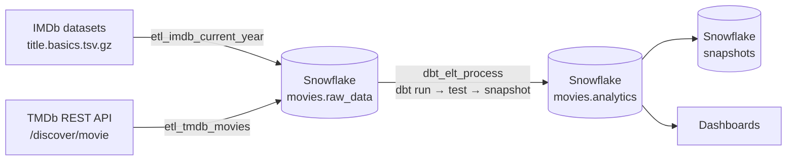

# Cinema Analytics Platform

**Flicks and Figures: A Data-Driven Dive into Cinema** is an ELT pipeline that brings IMDb and TMDb movie data into Snowflake, orchestrated with Apache Airflow and modeled with dbt. It loads 18K+ movie records and builds analytics tables for genre, release-year, language and popularity analysis.

> Graduate team project (five people) for DATA 226 *Data Warehouse and Pipelines* at San José State University, Fall 2024.

## Architecture



Everything runs locally in Docker: Airflow 2.9 (LocalExecutor) with a PostgreSQL metadata database, connecting out to Snowflake.

## Pipelines

| DAG | File | Schedule | What it does |
|---|---|---|---|
| `etl_imdb_current_year` | `airflow/dags/imdb_historical.py` | Manual | Downloads the IMDb `title.basics` dataset, keeps movies released in the current year, drops incomplete rows, deduplicates on `tconst` and MERGEs into `raw_data.imdb_data_movies`. |
| `etl_tmdb_movies` | `airflow/dags/tmdb_realtime.py` | Sundays 00:00 | Pages through the TMDb Discover API for US releases from the last 7 days, maps genre IDs to names, cleans the popularity and vote metrics, and MERGEs into `raw_data.tmdb_data_movies` with bound parameters. Records the last processed release date in an Airflow Variable. |
| `dbt_elt_process` | `airflow/dags/dbt_elt_process.py` | Sundays 00:30 | Runs `dbt run`, then `dbt test`, then `dbt snapshot`, passing Snowflake credentials from the Airflow connection as environment variables. |

Both ingestion DAGs use `MERGE` statements, so re-running them updates existing rows instead of duplicating them.

**Missing TMDb metrics.** Zero is a real value for popularity, vote average and vote count (a new release may have no votes yet), so zeros are kept. Missing, non-numeric, NaN or negative values are stored as `NULL`. The analytics models exclude or sort past `NULL` popularity so unknown values never rank at the top. The cleaning logic lives in `airflow/dags/tmdb_transform.py`, separate from Airflow so it can be unit tested.

## dbt models

**Staging** (view)
- `staging_imdb_tmdb_movies`: joins TMDb releases to IMDb titles and genres.

**Analytics** (tables)

| Model | Output |
|---|---|
| `movies_by_genre` | Movie count per genre |
| `avg_vote_count_by_genre` | Average vote count per genre |
| `most_popular_genres` | Movie count and average popularity per genre |
| `movies_by_release_year` | Movies and average popularity per release year |
| `avg_popularity_by_language` | Average popularity and movie count per original language |
| `top_10_most_popular_movies` | Ten most popular movies |

**Data quality tests** (4): `not_null` and `unique` on `top_10_most_popular_movies.movie_id`, plus `not_null` on `most_popular_genres.genre_name` and `avg_popularity_by_language.original_language`.

**Snapshots** (7): one per analytics model, using the `check` strategy so changes in the aggregates are tracked over time in the `snapshots` schema.

## Repository structure

```
cinema-analytics-platform/
├── airflow/
│   ├── docker-compose-min.yaml   # Airflow + PostgreSQL stack
│   ├── dags/                     # IMDb, TMDb and dbt DAGs + tmdb_transform.py helpers
│   ├── dbt_movie/                # dbt project: models, tests, snapshots
│   ├── tests/                    # pytest unit tests for the TMDb transformation
│   ├── config/  logs/  plugins/  # mounted into the Airflow containers
├── docs/
│   └── flicks-and-figures-presentation.pptx   # final project presentation
├── .github/workflows/tests.yml   # runs pytest on every push
└── pytest.ini
```

## Run it locally

**Prerequisites:** Docker Desktop, a Snowflake account, and a free [TMDb API key](https://developer.themoviedb.org/docs/getting-started).

1. **Start Airflow**

   ```bash
   cd airflow
   docker compose -f docker-compose-min.yaml up -d
   ```

   The Snowflake provider, Snowflake connector, dbt-snowflake and requests are installed at startup. The Airflow UI is at http://localhost:8081 (default login `airflow` / `airflow`).

2. **Create the Snowflake database and schema** used by the DAGs:

   ```sql
   CREATE DATABASE IF NOT EXISTS movies;
   CREATE SCHEMA IF NOT EXISTS movies.raw_data;
   ```

3. **Add the Airflow connection** `snowflake_conn` (Admin → Connections, type *Snowflake*) with your login, password and schema, and put `account`, `database`, `role` and `warehouse` in the connection's *Extra* field. The dbt DAG reads all of these and passes them to `airflow/dbt_movie/profiles.yml` as environment variables, so no credentials live in the repo.

4. **Add the Airflow Variable** `tmdb_api_key` (Admin → Variables) with your TMDb key.

5. **Run the DAGs** in order: `etl_imdb_current_year`, then `etl_tmdb_movies`, then `dbt_elt_process`.

## Tests

The TMDb transformation has unit tests that run without Airflow or Snowflake:

```bash
pip install -r requirements-dev.txt
pytest
```

They check that zeros are kept, that missing and invalid values become `NULL`, that output is deterministic, that `NULL` is sent as a bound parameter rather than as text, and that only last-week releases are kept. GitHub Actions runs them on every push.

## My contributions

I co-developed the Python ingestion DAGs, TMDb REST API extraction, MERGE-based incremental loads and the Dockerized Airflow setup, and developed the Snowflake SQL transformations for the genre, release-year and popularity models.

## Possible improvements

- Load records in bulk (stage + `COPY INTO`, then one `MERGE`) instead of one `MERGE` per row.
- Move the IMDb DAG to bound parameters and unit-tested helpers, like the TMDb DAG.
- Join IMDb and TMDb on a shared ID instead of exact title match.
- Add tests on the staging model, such as `not_null` and `accepted_range` on popularity and vote count.

## Tech stack

Python · Apache Airflow 2.9 · Snowflake · dbt · SQL · Docker Compose · PostgreSQL · TMDb API · IMDb datasets
